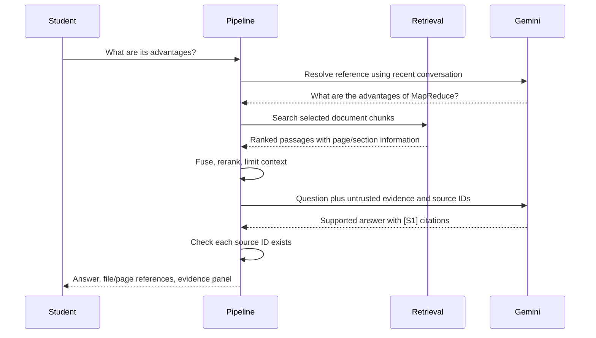

# Explaining Atlas to a university supervisor

## The problem

A general chatbot may answer from its training rather than the student's lecture notes. Retrieval-Augmented Generation (RAG) first finds relevant passages in supplied documents and then asks a language model to answer using those passages. Atlas makes that process visible: each answer has references, and a panel shows exactly what the model received.

## From upload to searchable knowledge

Imagine uploading a 40-page PDF and an Excel table. The application validates them without executing their contents. PDF text keeps its original page number. Spreadsheet rows keep the worksheet and row number. Long passages become smaller chunks, with each child connected to a larger parent section. The original bytes, metadata and chunks are stored locally in SQLite, a small database file. Duplicate files are recognized by a SHA256 fingerprint of their contents.

An embedding converts a passage into a list of numbers. Related meanings should have similar numbers when using Gemini's learned embedding model. Atlas normalizes these float32 lists so FAISS inner product measures cosine similarity. The stored vectors are reused next time; a new file only needs new vectors for its own chunks. Changing embedding settings creates a separate compatible cache. The offline demonstration replaces learned embeddings with word hashes and cannot demonstrate real semantic understanding.

## How a question is answered

Dense search finds similar meanings using vectors. Sparse search finds matching words using BM25Plus, which considers word frequency and document length. Hybrid search combines both rankings with Reciprocal Rank Fusion: a passage gets more credit when it ranks highly in either list. Because cosine and BM25 scores have different units, Atlas combines ranks rather than adding incompatible raw scores.

Reranking examines retrieved candidates again before the model receives them. The lightweight default measures word coverage. A downloaded multilingual cross-encoder can instead score query-passage pairs with a neural model. Reranking scores and vector similarities are not calibrated probabilities that an answer is correct.

## The different RAG approaches

**Naive RAG** is the basic baseline: one query, vector search, then an answer. **Advanced RAG** is the broader family of improvements before and after that search, such as better chunking, query rewriting, hybrid fusion, reranking and verification. It is not a single separate algorithm.

**Conversational RAG** resolves references using recent questions. For example, “its advantages” becomes “the advantages of MapReduce.” It avoids sending the whole chat every time. **Hybrid RAG** combines meaning-based and word-based search. **Multi-Query RAG** asks the model for several equivalent search questions and combines their evidence, helping recover relevant passages that one phrasing might miss.

**Parent-Document RAG** finds small precise chunks but sends larger surrounding sections, improving context without searching only large blocks. A parent never crosses a PDF page, so citations remain honest.

**Corrective RAG** checks the retrieval result, retries once when a simple query-word coverage heuristic looks weak, and abstains if it still finds no matching evidence. This implementation uses a transparent low-cost heuristic; it does not claim that word overlap equals semantic relevance.

**Self-RAG / self-reflective RAG** examines whether the answer is supported after generation. Atlas uses a separate model judgment and at most one revision, followed by another check. If the check fails or is unavailable, it abstains. This is an application-level self-reflection workflow, not training a specialized Self-RAG research model. Model judgments can still be mistaken.

**Agentic RAG** chooses an appropriate tool rather than always following one search path. Atlas uses a small rule-based agent with semantic, keyword, hybrid and metadata tools. A comparison can run searches separately for documents. Every decision is recorded. The agent has a three-call default budget and cannot execute code, browse or invent a tool result.

## Why citations matter

Passages are given temporary IDs such as S1. The model may only reference those IDs. The application rejects an unknown ID and renders valid IDs as a filename plus real page or section. The source panel distinguishes what was retrieved from what the answer actually cited. This prevents fabricated source identifiers; it does not mathematically prove every claim follows from its citation. Reflection offers another check, with the limitations already described.

## How quality is measured

An evaluation question has a known set of relevant documents and a reference answer. Precision@K measures how many of the first K document results are relevant. Recall@K measures how many relevant documents were recovered. MRR rewards finding a relevant document early. Hit rate asks whether any relevant document was found. nDCG rewards placing relevant documents near the top, using decreasing rank weights.

Atlas computes those metrics against actual results for dense, BM25, hybrid and reranked hybrid retrieval. It does not fill a table with invented numbers. The included five questions are an example smoke dataset, not a large research benchmark. Answer/reference word overlap is labeled a lexical proxy. Optional relevance, faithfulness and completeness judgments are labeled as model judgments rather than ground truth.

## Engineering choices and limits

SQLite preserves the library and chats between restarts. FAISS preserves efficient vector search. Embedding caches avoid repeated API costs. Retries handle temporary failures and API errors are redacted. Heavy OCR and neural reranking dependencies are optional so an ordinary Windows laptop can run the application. A fully offline demonstration is useful for teaching and automated tests; genuine semantic retrieval and generated reasoning require the Gemini API.

Documents are untrusted inputs. The model is told not to follow instructions hidden inside them. Uploaded files are validated and never executed. Credentials stay in environment configuration and do not appear in traces. Public deployment would still require authentication, isolation and further security controls. Answers are validated before display, so live token streaming is deferred. Complex table layouts, whole-document summaries and Arabic morphology remain areas for improvement.

For the demonstration, load the three example documents, ask about MapReduce in English, ask a follow-up, ask in Arabic, compare Spark, inspect citations, switch modes and run the evaluation. Use the trace and performance tabs to explain what happened and how long each stage took. See README for exact commands and VALIDATION for executed test evidence.

## The professional workspace extension

The interface now separates chat, the document library, search experiments, evaluation, activity and settings. Uploads are processed in the background so the student can keep using the workspace. A small job history shows what completed or failed. If the app stops, unfinished uploads must be resubmitted; the application does not pretend to provide a distributed job system.

Hybrid retrieval can give more weight to meaning-based or keyword ranking. After reranking, maximal marginal relevance (MMR) balances relevance against repetition: two nearly identical chunks are less useful than a relevant chunk plus additional supporting context. Atlas uses cached semantic vectors when available and local TF-IDF otherwise, with no extra embedding requests for this selection step. The relevance term uses the original ranking rather than a calibrated probability.

Search studio lets a supervisor inspect dense, sparse and hybrid results without generating an answer. The trace shows stage timing, changes in candidate order and the final context budget. Evaluation runs keep their configurations, dataset fingerprint and library revision, making it possible to check whether comparisons use equivalent conditions. Candidate retrieval metrics are measured before MMR context selection.

Students can save answers, mark them helpful or needing review, and leave notes. This is user feedback, not an automatic correctness score. Source highlights escape HTML and Arabic excerpts are displayed right to left. Settings and source selections survive restarts, with separate document scope for each conversation. These additions improve the engineering and presentation while retaining the local-only and model-verification limits already explained.
