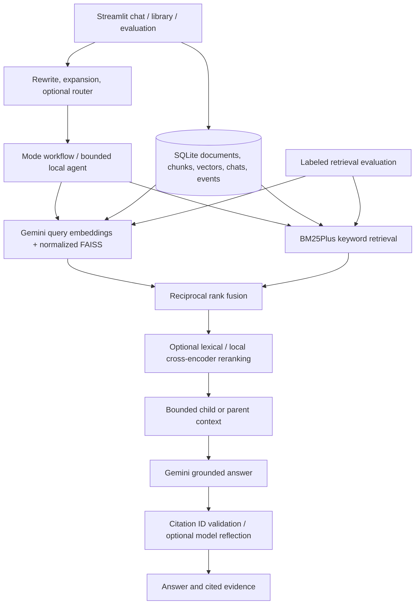

# Atlas — Advanced RAG Platform

A local Windows application for asking evidence-grounded questions across PDF, TXT, Markdown, DOCX, CSV and XLSX documents. Streamlit provides chat, a persistent library, multiple conversations, query traces, a measured evaluation lab and performance charts. Gemini supplies semantic embeddings and answers; FAISS and SQLite run locally. An offline demo uses deterministic lexical hash vectors and extracts quotes, so the application remains testable without credentials.

This implementation was built in the initially empty `BigRag` folder after inspecting the adjacent `Mini-RAG` project. It retains its working Google GenAI SDK integration, retry/redaction behavior, normalized FAISS retrieval, page-preserving PDF extraction and grounded-answer design. The original project, uploaded PDF, caches and credentials were left intact. Existing pickle caches are **not** imported: add original documents through the uploader to rebuild safe metadata.

## Install and start (PowerShell, Python 3.13)

```powershell
cd C:\Users\osama\OneDrive\Desktop\BigRag
py -3.13 -m venv .venv
.\.venv\Scripts\python.exe -m pip install -r requirements.txt
if (-not (Test-Path .env)) { Copy-Item .env.example .env }
# Edit .env and set GEMINI_API_KEY; offline demo needs no key.
.\.venv\Scripts\python.exe -m streamlit run app.py
```

Open [http://localhost:8501](http://localhost:8501). No environment activation is required. The current workspace already has an installed `.venv`; run the last command to launch. The server binds to `127.0.0.1` by default.

## Use

1. Choose Gemini or Offline demo in **Answer controls**. The demo is explicitly labeled and makes no network requests. The sidebar has focused Workspace, Documents, Search studio, Evaluation, Activity and Settings pages.
2. Open **Documents → Add documents**, upload files and click **Index uploads**, or use **Quick start → Load example documents**. Uploads are processed by a bounded background worker with a persistent job history. The sparse library is available after extraction; dense embeddings are generated and cached on the first dense/hybrid search.
3. Select the documents for the question, a RAG mode, and retrieval method. An empty document selection disables chat; it does not search the entire library.
4. Ask in English or Arabic. Open **Evidence** to distinguish cited passages from retrieved passages. Open optional **Query trace** for rewriting, candidate rankings, context and agent decisions.
5. Add, rename, clear and export conversations. They survive app restarts in SQLite and retain their own document selection, RAG mode and query controls. Mark an answer Helpful/Needs review, leave a review note, save it or download Markdown. Saved answers appear in Activity.
6. Preview, reindex or delete individual documents. Deletion removes raw uploads, chunks, embedding rows, query cache, FAISS representations and copied evidence/debug passages from stored chats. Historical answer text remains with a deletion notice; exports already downloaded remain on disk.
7. Run **Evaluation** after loading the example documents, or upload your own labeled JSON. Each run persists its settings, dataset fingerprint and library revision; compare previous runs and inspect per-question scores. **Activity** shows measured median/p95 latency, API failed attempts, token metadata, job history and feedback.
8. Use **Search studio** to compare dense, sparse and hybrid search without calling the answer generator. Explore ranking scores and the context selected after reranking and diversity selection; export the experiment.
9. Save retrieval, model and chunk settings on **Settings**. Use the hybrid semantic weight, MMR relevance balance and per-document cap to tune the selected evidence. These controls persist locally; exported configuration contains no API key.

Changing embedding model/dimension/backend automatically creates compatible vectors/indexes. Changing chunk settings applies to new documents; explicitly reindex existing documents. Identical bytes are deduplicated even when the uploaded filename differs. Two different files with the same name remain separate document IDs.

## Architecture



| Module | Responsibility |
|---|---|
| `config.py` | Validated settings, resource limits, cache fingerprints |
| `rag/ingestion.py` | Safe formats, page/section extraction, optional OCR |
| `rag/chunking.py` | Fixed, recursive, sentence, semantic and parent-child chunks |
| `rag/storage.py` | SQLite transactions, raw bytes, tokens, vectors, sessions, events |
| `rag/library.py` | Duplicates, ingestion and reindex orchestration |
| `rag/embeddings.py` | Gemini SDK, timeouts, retries, redacted errors; demo provider |
| `rag/retrieval.py` | Persistent normalized FAISS, cached query vectors, BM25Plus, RRF |
| `rag/query.py` | Conditional conversational rewrite, expansion, router |
| `rag/reranking.py` | Local lexical coverage or optional multilingual cross-encoder |
| `rag/agent.py` | Validated bounded retrieval/metadata/comparison tool selection |
| `rag/generation.py` | Context budget, source IDs, citation validation, reflection |
| `rag/pipeline.py` | Distinct workflows, telemetry and safe orchestration |
| `rag/evaluation.py` | Labeled retrieval metrics, lexical proxies, optional model judgments |
| `ui/components.py`, `app.py` | Chat, evidence, library, settings and dashboards |
| `scripts/`, `tests/` | Evaluation CLI, real API smoke test and automated validation |

SQLite is the source of truth. Raw uploads are BLOBs, not paths derived from filenames. Chunk metadata and sparse tokens use JSON. Embedding cache keys include backend, model, dimension and task; query and document embeddings use separate task types. Normalized float32 vectors make inner product equivalent to cosine similarity. Index files use atomic replacement and checksummed manifests; missing or inconsistent indexes rebuild from cached vectors. Only new/changed chunk IDs require new document embeddings. Unchanged reindexing preserves embeddings. Collection indexes are assembled locally, so adding a document does not re-embed the entire library. Existing libraries migrate through additive tables for preferences, jobs, evaluation history and feedback without rewriting uploaded bytes. Reading order is retained through chunk ordinals and older chunks use page/parent provenance and text offsets.

Hybrid search now uses weighted RRF (default semantic weight 0.6, keyword weight 0.4). Candidate traces retain both cosine and BM25 component scores. Multi-query fusion still uses equal query weights. MMR context selection balances normalized reciprocal-rank relevance with maximum pairwise cosine redundancy; it reuses compatible cached semantic vectors, or local TF-IDF when those vectors are unavailable. It makes no extra embedding requests. The optional per-document cap applies before context construction. This is a rank-based MMR variant; it does not claim trained relevance calibration. The Naive baseline bypasses reranking and diversity selection.

Query traces include stage timings, configuration snapshots, context usage and a unique trace ID. Answer checks reject uncited factual paragraphs even when they follow Markdown headings. Highlighted evidence HTML is escaped before display, with automatic right-to-left rendering for Arabic excerpts.

## RAG modes

| Mode | Actual workflow |
|---|---|
| Naive | One original query, dense retrieval, child context, no rewriting/expansion/reranking |
| Conversational | Conditional follow-up rewrite using at most four recent messages, selected retrieval and reranking |
| Hybrid | Forces dense + sparse RRF; optional rewriting/expansion/reranking |
| Multi-Query | Adds up to three model-generated equivalents, retrieves each, fuses unique candidates |
| Parent-Document | Searches children, deduplicates parents, supplies larger same-page sections |
| Corrective | Uses query token coverage as a lightweight relevance heuristic; retries once with cleaned query and hybrid search; abstains when no overlap remains |
| Self-Reflective | Validates citations, asks a model to assess support, revises at most once, judges again and abstains on failure |
| Agentic | Deterministic constrained agent chooses semantic/keyword/hybrid/metadata tools; compares documents through separate searches; default three steps, hard maximum five |

All modes support bounded representative-excerpt summaries. Summaries do **not** guarantee complete document coverage. Agentic comparison can only access documents within its step budget and records this limit. The agent has no shell, code execution, browsing or filesystem tool. Its decisions describe actual calls. Routing and rewriting can be disabled. Simple standalone queries avoid rewrite calls; multi-query and reflection intentionally make extra requests.

## Formats and limits

Uploads are limited to 25 MB by the UI and validated again in the backend. PDFs require a valid header, unlocked access and at most 2000 pages. Empty/unreadable pages produce warnings without shifting page numbers. Office ZIPs have entry/decompression caps. Extracted content is capped at 5 million characters and 10,000 nonempty extraction units. XLSX is read-only, uses cached formula results and does not evaluate formulas or external links. DOCX headings and tables are extracted in document order; CSV/XLSX rows preserve headers. DOCX pagination is not invented: these formats cite sections instead. Complex PDF tables remain best-effort plain text.

Parent sections never cross extraction-unit/page boundaries. Semantic chunking computes adjacent sentence similarities with a 0.55 split threshold and the configured size cap. It incurs extra embedding calls and is not a trained layout parser. Parent-child chunking uses recursive children within bounded parents; parent mappings also exist for other strategies. Character overlap is best-effort in sentence chunks to keep sentences bounded.

## Optional reranking and OCR

The default lexical reranker prioritizes query-token coverage plus a small original-rank tie-break. It is cheap and multilingual but is **not** a neural semantic reranker. For the local multilingual cross-encoder:

```powershell
.\.venv\Scripts\python.exe -m pip install sentence-transformers
# Explicit one-time model download (may be large):
.\.venv\Scripts\python.exe -c "from sentence_transformers import CrossEncoder; CrossEncoder('cross-encoder/mmarco-mMiniLMv2-L12-H384-v1')"
```

Select cross-encoder on Settings. Question processing loads only an already cached model; missing packages/model fall back to lexical reranking with a visible warning. Model loading is lazy and cached in the process.

For scanned PDFs, install `pymupdf` and `pytesseract`, install the Tesseract executable separately and add it to PATH with `eng` and `ara` language packs. Enable OCR and reindex the scan. OCR has a 30-second per-page timeout and image-size cap. OCR and neural reranking are optional and were validated through missing-dependency fallbacks; real local model/OCR execution requires those installations.

## Evaluation

The five-question fixture in `examples/evaluation.json` has English and Arabic queries, reference answers and relevant filenames, resolved to actual indexed document hashes. Custom datasets can supply `relevant_source_ids` (document SHA256 IDs shown in the library) to avoid filename ambiguity. Example:

```json
[{"question":"What is MapReduce?", "reference_answer":"Parallel data processing.",
  "relevant_source_ids":["actual-document-sha256"]}]
```

Precision@K is relevant retrieved unique documents divided by K; missing ranks count as misses. Recall@K divides by all labeled relevant documents. MRR uses the first relevant rank; hit rate is binary per question; nDCG uses binary relevance with log-discounted ranks. Duplicate child hits collapse to the first document occurrence. Aggregates average per-question results. Unlabeled documents count as nonrelevant, so quality depends on complete labels. The CLI defaults to K=5; UI uses up to the available document count. Candidate truncation can affect document coverage.

Comparisons run dense, BM25Plus, weighted hybrid and hybrid plus the selected reranker against the same labels. Embedding/query caches and optional reranker loading are warmed before timing, so reported latency measures local retrieval and excludes initial embedding API/model loading time. Retrieval metrics score the candidate rankings before MMR context selection; the search experiment shows MMR effects separately. Evaluation stops on dense/API failure rather than scoring a keyword fallback as hybrid. Results report backend and effective reranking fallbacks. Each run stores the exact configuration, dataset fingerprint and library revision. Compare runs directly only when dataset, labels, K and corpus are equivalent. Scores are measured only after a run; the demo's hash features cannot establish Gemini semantic retrieval quality.

Optional generation evaluation reports reference-token F1, reference coverage and evidence-token overlap as **lexical proxies**, plus citation ID validity. Optional Gemini judging reports relevance, faithfulness and completeness as **model-judged** scores with no factual correctness guarantee. It is disabled in demo mode. Five example questions are a smoke benchmark, not a representative enterprise quality assessment; supply larger domain-specific labels for meaningful claims.

```powershell
.\.venv\Scripts\python.exe -m scripts.evaluate --backend demo --load-examples --generation
# Real API usage; evaluates existing library against its labels:
.\.venv\Scripts\python.exe -m scripts.evaluate --backend gemini --load-examples --generation --model-judge
```

## Validation

```powershell
.\.venv\Scripts\python.exe -m pip install -r requirements-dev.txt
.\.venv\Scripts\python.exe -m pytest -q
.\.venv\Scripts\python.exe -m compileall -q app.py config.py rag ui scripts tests
.\.venv\Scripts\python.exe -m ruff check app.py config.py rag ui scripts tests
.\.venv\Scripts\python.exe -m pip check
# Optional: sends a small synthetic document to Gemini:
.\.venv\Scripts\python.exe -m scripts.smoke
```

Tests cover real PDF extraction (including missing pages), all six formats, five splitters, normalized dense retrieval, BM25/RRF, filtered retrieval, caching/invalidation/corruption, reindexing/deletion, conversation persistence, all eight workflows, API retries/redaction, citation rejection, bounded agents, metric formulas and Streamlit interactions. Most tests use a deterministic provider with real local storage and indexes. See `VALIDATION.md` for exact executed checks and `PROGRESS.md` for limitations.

## Reliability, privacy and security

Gemini batches embeddings in groups of 32. HTTP requests have a 60-second timeout and at most three application attempts for rate limits, transient server errors or transport failures. No model silently changes after a failed request. Hybrid can fall back to BM25 with an explicit warning; generation failures surface a redacted error. API failed attempts are recorded separately from query failures, with status code and attempt only. Indexes/vectors persist; query-vector cache is capped at 500 entries. Generation outputs are buffered until citations are validated; token streaming is deferred to avoid showing unvalidated references. Context is capped at 14,000 characters and history is restricted to reference resolution.

Keys come from environment variables or a gitignored `.env`. Neither raw exception text nor API secrets are logged. Retrieved passages are serialized as untrusted evidence under a system instruction; only existing citation IDs may be rendered. Unsupported/uncited/malformed-source answers abstain. Citation checks validate identity, not entailment. Prompt instructions and model self-checks reduce injection exposure but do not prove immunity.

This is a production-oriented **local single-user project**, not a hardened public multi-user service. It has no authentication, tenant isolation, encryption at rest, malware scanner or reliable distributed locking. Do not expose it publicly without those controls. Native parsers still process hostile inputs; limits are not process isolation. FAISS files must remain in the trusted application-managed directory; checksums detect corruption, not malicious tampering by a local attacker. SQLite deletes are logical deletion rather than forensic secure erasure. Chat answers remain after source deletion; downloaded exports and OneDrive backups are outside application control. Gemini processing is external even though storage is local; do not upload confidential files unless permitted. Prefer a non-synced local `RAG_DATA_DIR` for SQLite; avoid concurrent app processes/OneDrive file conflicts.

## Troubleshooting and future work

- Missing key: set `GEMINI_API_KEY` in `.env`, restart, or select Offline demo. Model availability/quota depends on your Google account.
- Unavailable model: choose an accessible generation model; the requested default was verified against the API during implementation. [Google model documentation](https://ai.google.dev/gemini-api/docs/models/gemini-3.5-flash-lite).
- Dimension mismatch: settings create a different cache; retry/reindex after changing the configured dimension. [Google embedding task types](https://ai.google.dev/gemini-api/docs/embeddings).
- Scans/empty PDFs: enable configured OCR or upload a text-based copy; encrypted PDFs need unlocking first.
- Office formulas look blank: open and save the workbook in Excel so formula results are cached.
- Poor retrieval: try hybrid, tune chunk size, increase candidates, select relevant files and measure using labeled queries. Sparse tokenization is Unicode-aware with basic Arabic diacritic normalization, not morphological stemming.
- Cross-encoder missing: install/download the optional model or retain lexical reranking.
- SQLite locked: run one local app process, keep data outside synchronized directories and retry after closing other writers.
- Windows pip failure: confirm 64-bit Python 3.13 and install with the `.venv` interpreter. Optional Torch packages may require a compatible CPU wheel.

Future extensions: authenticated API/tenant boundaries, parser subprocess isolation, full-document hierarchical summaries, calibrated evidence relevance, stronger Arabic analyzers, larger human-labeled evaluation, citation entailment models, hybrid search weighting and production backups/migrations. Source-gated token streaming and distributed index coordination are deferred.
